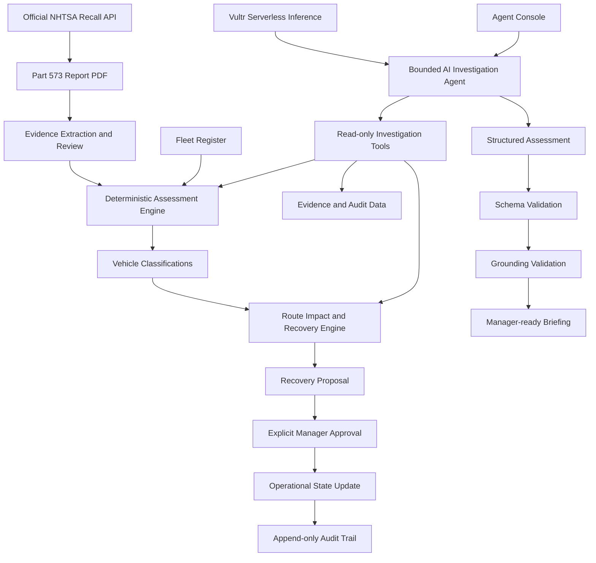
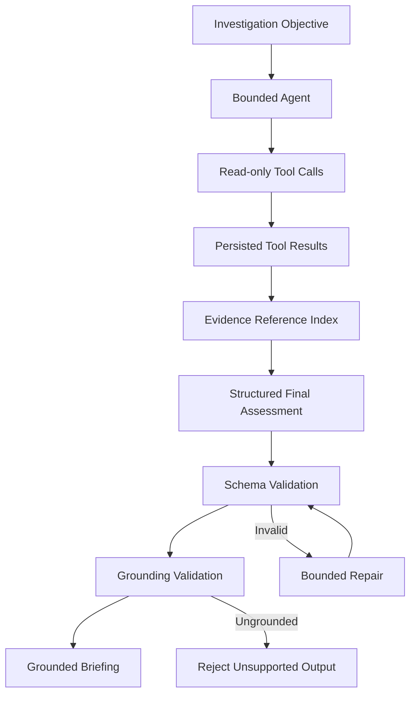
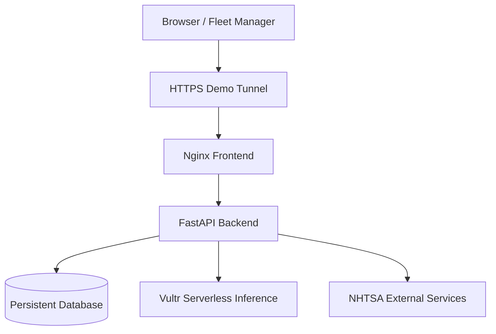

# RouteShield

### Evidence-Grounded AI Investigation for Safer Fleet Operations

**RouteShield** is an AI-powered fleet safety investigation and operational decision-support system that helps fleet managers investigate vehicle recalls, assess fleet-wide exposure, evaluate route disruption, and identify feasible recovery options — all while keeping safety-critical decisions deterministic and under human control.

Built for the **Vultr Agent Rush Hackathon 2026**.

[](https://www.python.org/)
[](https://fastapi.tiangolo.com/)
[](https://react.dev/)
[](https://www.typescriptlang.org/)
[](https://www.docker.com/)
[](https://www.vultr.com/)

---

## The Problem

Vehicle recalls create more than a maintenance problem. For fleet operators, a single recall can affect multiple vehicles, scheduled routes, spare capacity, depot assignments, and service continuity.

Fleet managers need to answer several questions:

- Which vehicles match the recall's applicability criteria?
- Which vehicles require additional verification?
- Which vehicles fall outside the specific report's applicability criteria?
- How would different operational policies affect scheduled routes?
- Are there enough compatible spare vehicles?
- Which replacement assignments create resource contention?
- What evidence supports each recommendation?

These questions often require information scattered across recall documents, fleet registers, maintenance records, and operational systems.

RouteShield brings this information into a single evidence-grounded investigation workflow.

## Our Solution

RouteShield combines a deterministic safety assessment engine with a bounded AI investigation agent.

The deterministic backend evaluates recall applicability and calculates operational impact. The AI agent orchestrates read-only tools, investigates the returned evidence, compares scenarios, and prepares a structured briefing for the fleet manager.

**The AI investigates. The deterministic engine decides classifications. The human manager authorizes operational changes.**

### Core Capabilities

| Capability | Description |
|---|---|
| Live Recall Retrieval | Retrieves recall campaign information from the official NHTSA API and its Part 573 report. |
| Evidence Extraction | Extracts applicability criteria, production windows, feature codes, exclusions, and document provenance. |
| Deterministic Fleet Assessment | Evaluates fleet records against reviewed recall criteria without relying on LLM classification. |
| Vehicle Classification | Identifies campaign criteria matches, vehicles requiring verification, and vehicles outside the report version. |
| Route Impact Analysis | Compares operational consequences under different fleet policies. |
| Spare Vehicle Matching | Evaluates replacement capacity, depot compatibility, and required equipment. |
| Resource Contention Detection | Identifies when multiple routes depend on the same available spare. |
| AI Investigation Agent | Uses bounded, read-only tools to investigate the fleet and generate a grounded assessment. |
| Human Approval Workflow | Requires explicit manager authorization before operational changes. |
| Audit Trail | Preserves an append-only record of operational decisions and actions. |

---

## Core Safety Principles

RouteShield is designed around a strict separation between AI reasoning and operational authority.

### 1. Absence of evidence is not evidence of safety

A vehicle is never declared safe merely because the system cannot establish recall applicability.

When critical evidence is missing or conflicting, the deterministic assessment engine abstains and classifies the vehicle as `VERIFICATION_REQUIRED`.

### 2. Deterministic classifications

The LLM does not classify vehicles.

Vehicle classifications are produced by the deterministic assessment engine using the reviewed applicability criteria and available fleet records.

### 3. Read-only AI investigation

The investigation agent can retrieve information, inspect fleet records, examine evidence, and preview route impact.

It cannot independently change vehicle assignments, place operational holds, approve recovery plans, or modify fleet state.

### 4. Explicit manager approval

Operational changes require authorization through the manager approval workflow.

The approval path revalidates the proposed plan and spare availability before applying changes.

### 5. Evidence-grounded responses

The agent's final assessment must pass schema and grounding validation against persisted tool outputs.

Evidence references, vehicle identifiers, and route identifiers are treated as distinct identifier types. Unsupported references are rejected rather than silently accepted.

---

## System Architecture

RouteShield consists of five major layers:

1. Recall and evidence ingestion
2. Deterministic fleet assessment
3. AI investigation and tool orchestration
4. Route recovery and resource analysis
5. Human approval and audit

### High-Level Architecture



### AI Investigation Architecture

The bounded investigation agent uses Vultr Serverless Inference to reason over information returned by dedicated backend tools.

The agent does not receive unrestricted database access.

Its available tools are read-only:

| Tool | Purpose |
|---|---|
| `get_recall_evidence` | Retrieves reviewed recall evidence and applicability criteria. |
| `get_fleet_assessment` | Retrieves deterministic fleet classifications. |
| `preview_route_impact` | Simulates route disruption under a selected policy. |
| `get_available_spares` | Retrieves available spare vehicles and eligibility information. |
| `get_open_verification_items` | Retrieves unresolved vehicle verification work. |
| `get_audit_trail` | Retrieves the incident's audit history. |
| `get_vehicle_detail` | Retrieves details for an individual fleet vehicle. |

The agent operates with bounded investigation rounds and validates its final structured assessment before presenting it.

### Grounding and Validation Pipeline



The final assessment is accepted only when its structure and references satisfy the validation requirements.

---

## Technology Stack

### Backend

- Python 3.11+
- FastAPI
- Pydantic
- SQLAlchemy
- PyMuPDF
- Pytest

### Frontend

- React
- TypeScript
- Vite
- Tailwind CSS

### AI and Inference

- Vultr Serverless Inference
- Qwen inference model (`qwen3.8-flash-next`)
- Bounded tool-calling agent
- Structured output validation
- Evidence grounding validation

### Infrastructure

- Vultr Cloud Compute
- Docker
- Docker Compose
- Nginx
- Cloudflare Tunnel for public demo access

### External Data

- NHTSA Recall Campaign API
- Official NHTSA Part 573 recall reports

---

## Demonstration: NHTSA Recall Campaign 26V111

RouteShield was tested against NHTSA campaign **26V111**, involving certain International Motors IC Bus CESB school buses and a potential hydraulic brake-line issue.

The system retrieved the campaign information and its Part 573 report, extracted the applicability criteria, and evaluated a synthetic fleet of 15 vehicles.

**Important:** The recall campaign is real, but the fleet records used in this demonstration are synthetic. They are not real vehicles, and the assessment is not a VIN-level recall confirmation.

### Fleet Assessment Results

| Classification | Vehicles |
|---|---:|
| `CAMPAIGN_CRITERIA_MATCH` | 3 |
| `VERIFICATION_REQUIRED` | 4 |
| `OUTSIDE_REPORT_VERSION` | 8 |
| **Total** | **15** |

### Route Policy Comparison

RouteShield compared two operational policies using read-only route previews.

| Metric | HOLD_PENDING_VERIFICATION | MANAGER_REVIEW_ONLY |
|---|---:|---:|
| Disrupted routes | 5 | 3 |
| Unresolved constraints | 2 | 0 |
| Routes flagged for review | 0 | 2 |

The distinction matters:

- `HOLD_PENDING_VERIFICATION` removes both criteria-matched and verification-required vehicles from the proposed dispatch allocation.
- `MANAGER_REVIEW_ONLY` removes criteria-matched vehicles while retaining verification-required assignments for manager review.

Retaining an assignment does not establish that the vehicle is safe.

### Spare Vehicle Analysis

The investigation identified three eligible spare vehicles.

| Route | Proposed spare | Result |
|---|---|---|
| R-101 | SYNTHETIC-SPARE-01 | Feasible |
| R-102 | SYNTHETIC-SPARE-02 | Feasible |
| R-103 | SYNTHETIC-SPARE-02 | Feasible individually |
| R-104 | None | No feasible spare under hold policy |
| R-105 | None | No feasible spare under hold policy |

The agent identified a critical resource contention issue:

`SYNTHETIC-SPARE-02` is the only feasible replacement for both R-102 and R-103. It cannot serve both simultaneous routes.

This is the kind of operational constraint that a simple recall lookup or chatbot would not identify.

### Successful End-to-End Investigation

The updated Agent v2 workflow successfully completed the fleet-wide investigation.

| Metric | Result |
|---|---|
| Investigation trace | `INV-995660A3AAE1` |
| Inference model | `vultr:qwen3.8-flash-next` |
| Investigation rounds | 7 / 8 |
| Tool calls | 9 |
| Duration | 58.9 seconds |
| Final schema validation | Accepted |
| Grounding validation | Passed |
| Operational actions executed | None |

The final assessment was accepted after a deterministic schema repair.

The agent produced a grounded briefing containing vehicle classifications, route impact comparisons, spare vehicle constraints, resource contention, evidence references, unknowns, and proposed manager decisions.

---

## Deployment Architecture

RouteShield is deployed on a Vultr Cloud Compute virtual machine using Docker Compose.

The application is separated into backend and frontend services, with a persistent database volume.

Vultr Serverless Inference provides the inference capability used by the investigation agent.



### Deployment Components

| Component | Responsibility |
|---|---|
| Vultr Cloud Compute | Hosts the application and Docker services. |
| Docker Compose | Runs and manages application containers. |
| Nginx | Serves the frontend and proxies API requests. |
| FastAPI | Handles business logic, tools, assessments and approvals. |
| Database | Persists fleet, incident, evidence, and audit information. |
| Vultr Serverless Inference | Powers the bounded AI investigation agent. |
| Cloudflare Tunnel | Provides HTTPS access to the demonstration frontend. |

The public demonstration endpoint exposes the frontend only. Backend and database services are not intentionally exposed as public application ports.

---

## Getting Started

### Requirements

- Python 3.11+
- Node.js 20+
- npm
- Git
- Docker and Docker Compose (for containerized deployment)

### 1. Clone the Repository

```bash
git clone https://github.com/Anirudh2627/Route-Shield.git
cd Route-Shield
```

### 2. Configure Environment Variables

```bash
cp .env.example .env
```

Configure the required manager credentials and authentication secret.

For a local setup, the LLM integration is optional. For AI-powered investigation, configure the Vultr Serverless Inference environment variables.

Never commit `.env` or API keys to Git.

### 3. Run the Backend

```bash
cd backend

python -m venv .venv
```

Activate the environment.

**Windows PowerShell:**

```powershell
.\.venv\Scripts\Activate.ps1
```

**Linux/macOS:**

```bash
source .venv/bin/activate
```

Install dependencies:

```bash
pip install -r requirements.txt
```

Start the backend:

```bash
uvicorn app.main:app --reload --host 127.0.0.1 --port 8000
```

The backend API documentation is available at:

`http://127.0.0.1:8000/docs`

### 4. Run the Frontend

Open another terminal:

```bash
cd frontend
npm install
npm run dev
```

Open the local frontend URL printed by Vite.

### 5. Run with Docker Compose

From the repository root:

```bash
docker compose up -d --build
```

Inspect running services:

```bash
docker compose ps
```

Stop the local deployment:

```bash
docker compose down
```

For the Vultr deployment, consult `DEPLOYMENT.md` and configure production secrets before starting the services.

---

## Testing

The backend includes automated tests covering assessment logic, agent orchestration, schema validation, grounding, and related safety behavior.

Run the backend test suite:

```bash
cd backend
python -m pytest -q
```

**Latest verified result for the Agent v2 P0 grounding-fix integration:**

```text
154 passed in 24.95s
```

The successful staging investigation also passed final schema and grounding validation.

---

## Repository Structure

```text
Route-Shield/
│
├── backend/
│   ├── app/
│   │   ├── main.py
│   │   ├── config.py
│   │   ├── db.py
│   │   ├── models.py
│   │   ├── schemas.py
│   │   ├── auth.py
│   │   ├── seed.py
│   │   │
│   │   ├── services/
│   │   │   ├── agent.py
│   │   │   ├── assessment.py
│   │   │   ├── recovery.py
│   │   │   ├── approval.py
│   │   │   ├── audit.py
│   │   │   ├── evidence.py
│   │   │   ├── nhtsa.py
│   │   │   ├── pdf_extraction.py
│   │   │   └── llm_extraction.py
│   │   │
│   │   └── ...
│   │
│   ├── tests/
│   ├── requirements.txt
│   └── Dockerfile
│
├── frontend/
│   ├── src/
│   │   ├── views/
│   │   └── ...
│   ├── package.json
│   └── Dockerfile
│
├── scripts/
├── docker-compose.yml
├── .env.example
├── DEPLOYMENT.md
└── README.md
```

---

## Security and Limitations

RouteShield is a decision-support system, not an autonomous vehicle safety authority.

- Fleet classifications are deterministic and depend on the quality and completeness of the underlying fleet data.
- `CAMPAIGN_CRITERIA_MATCH` means the reviewed campaign criteria match the available vehicle record. It is not VIN-level confirmation of an open recall.
- `VERIFICATION_REQUIRED` means evidence is missing, conflicting, or insufficient.
- `OUTSIDE_REPORT_VERSION` means the vehicle is outside the applicability criteria of the specific report version assessed. It does not establish that the vehicle is safe or unaffected by other recalls.
- Synthetic demonstration records must never be treated as real fleet records.
- VIN-level recall verification is not claimed when the information is unavailable.
- The AI investigation agent has read-only tools and cannot independently execute operational actions.
- Operational changes require explicit manager approval.
- The public Cloudflare Quick Tunnel used for the demonstration is temporary and is not a production-grade permanent domain or uptime solution.

---

## Future Scope

Potential future improvements include:

- Integration with real fleet-management and maintenance systems.
- More comprehensive VIN-level recall verification workflows.
- Historical recall monitoring and automated evidence refresh.
- Multi-depot optimization and richer vehicle scheduling constraints.
- Additional recovery strategies for resource contention.
- Long-term incident analytics and operational reporting.
- Persistent, managed public deployment with a custom domain and access controls.

---

## Why RouteShield?

RouteShield is built around one principle:

> **AI should help people make better operational decisions — not silently make safety-critical decisions on their behalf.**

By combining deterministic assessment, evidence-grounded AI investigation, route simulation, resource analysis, and explicit human approval, RouteShield turns fragmented recall information into an actionable operational briefing.

**Investigate with evidence. Plan with constraints. Act with approval.**

---

## Links

- **GitHub Repository:** https://github.com/Anirudh2627/Route-Shield
- **Portfolio:** https://anirudhdv.vercel.app/
- **Hackathon:** Vultr Agent Rush 2026
- **Website LINK:** https://lights-talks-glasgow-valentine.trycloudflare.com/?


---

*Built with Python, FastAPI, React, TypeScript, Docker, and Vultr Serverless Inference.*
